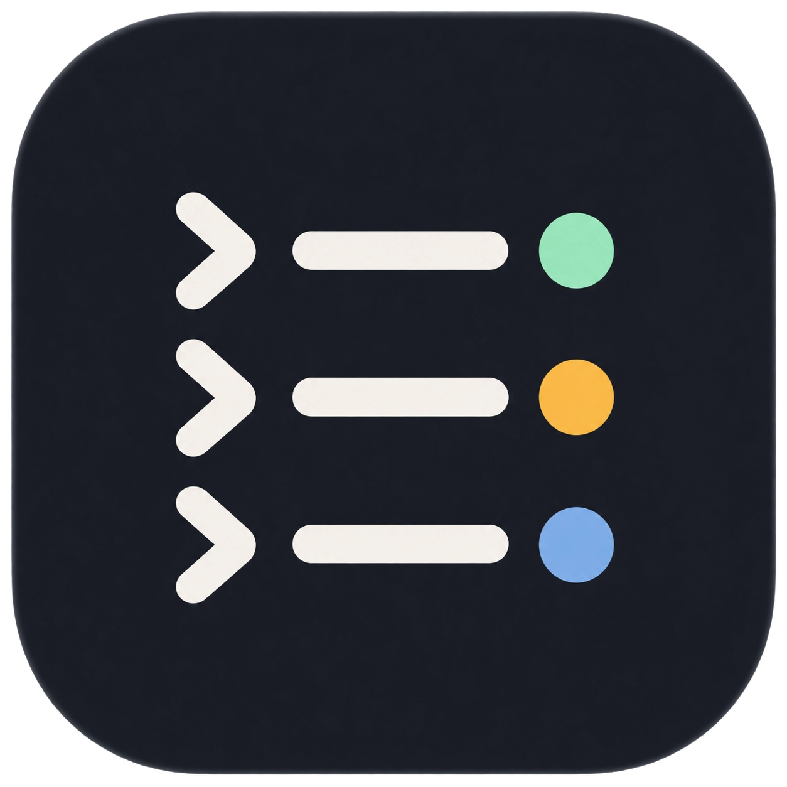
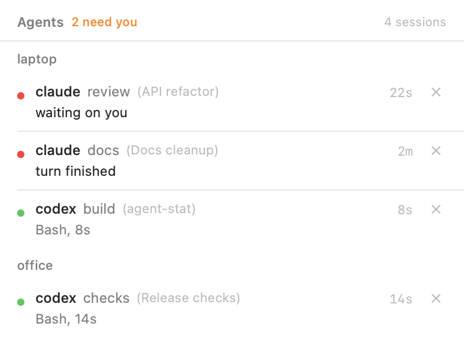
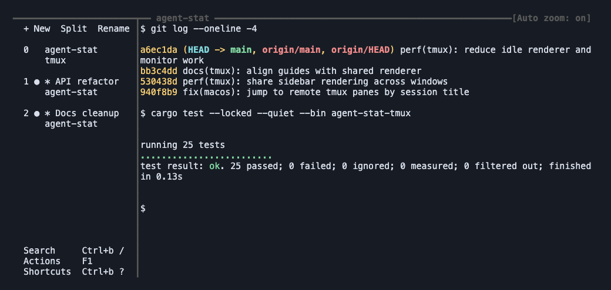

<p align="center">
  
</p>

<h1 align="center">agent-stat</h1>

<p align="center"><strong>Know which agent needs you.</strong></p>

<p align="center">Claude Code and Codex status, in your menu bar and your terminal.</p>

agent-stat shows which sessions are working, waiting for you, or finished.
Use the macOS menu bar panel across machines, or keep the optional tmux sidebar beside your work.

<table>
  <tr>
    <th align="left">macOS menu bar</th>
    <th align="left">tmux sidebar</th>
  </tr>
  <tr>
    <td valign="top" width="38%"><a href="docs/assets/macos-panel.png"></a></td>
    <td valign="top" width="62%"><a href="docs/assets/tmux-sidebar.png"></a></td>
  </tr>
  <tr>
    <td>See session status across machines. Click a session to return to its work.</td>
    <td>Switch panes, search sessions, and recover conversations without leaving tmux.</td>
  </tr>
</table>

<sub>Captures use demo session names and events. The panel uses an opaque background; the terminal image renders a tmux capture. Click either image to enlarge it.</sub>

## What you get

- **See what needs attention.** Status indicators distinguish work, permission requests, and finished turns.
- **Return to the right session.** Navigate from the panel or the terminal sidebar.
- **Use either interface.** The tmux sidebar works without the macOS app. Both read the same hook events.
- **Share the renderer.** With `--shared`, enabled tmux windows use one renderer per server.

The hooks write events and agent-stat reads them. It does not modify or wrap Claude Code or Codex.

## Build and run the macOS app

Use macOS 14 or later with the Swift compiler from Xcode or its Command Line Tools.
The shared hooks require `jq`. Use Python 3.11 or later for installation and tests.
Run these commands from the repository root:

```sh
bash build.sh
open .build/AgentStat.app
```

The build uses `swiftc` directly. It needs no Xcode project.
The tmux component is optional and is not required to build or run the app.

1. Run `python3 install.py` to inspect the shared hook installation.
2. Run `python3 install.py --apply` to install the hooks on this machine.
3. Codex reads its hooks at session start, so start a new Codex session. Claude Code
   re-reads its settings at once.
4. Click the icon. Rows appear as your sessions report.

For updates, quit the running app, rebuild it, and open the new bundle.
See the [app build guide](docs/guides.md#build-or-update-the-macos-app) for signing and login-item details.

The installer merges its entries into `~/.claude/settings.json` and
`~/.codex/hooks.json`, leaves every other hook alone, backs up both files first, and
writes the trust entries Codex needs. To remove it later, delete the entries whose
command contains `agent-stat`.

Events and deployed scripts live in `~/.local/state/agent-stat`, outside synced folders.
Run the installer on each machine. Add an `events` command to a remote route to receive
events over Secure Shell (SSH). Event delivery and script deployment require no Syncthing.
See [the second machine guide](docs/guides.md#report-from-a-second-machine).

## Terminal interface

The optional [tmux component](tmux/README.md) uses the same saved events.
It provides a persistent sidebar, colored status indicators, search, and conversation recovery.
It works without the macOS panel running and adds no duplicate status hooks.

The terminal component is a Rust binary with no Python runtime dependency.
Use `--shared` when installing or upgrading it to share one renderer across each tmux server.
Follow [your first sidebar session](tmux/docs/tutorial.md) to build, install, and try it.
Shared hooks are optional when you do not need agent status dots.

## Documentation

| Document | What is in it |
|---|---|
| [tmux/README.md](tmux/README.md) | Start here for the terminal tutorial, how-to guides, reference, and explanation. |
| [docs/guides.md](docs/guides.md) | Build or update the app, navigate sessions, configure login, and receive events from another machine. |
| [docs/reference.md](docs/reference.md) | What each colour means, what a row says, the shape of the events file, where the files live, the messages a click can print, and the timing constants. |
| [docs/how-it-works.md](docs/how-it-works.md) | Why one writer per file, why the hook cannot block an agent, why a remote click needs a route, and why the fold is deterministic. |

Tests and development aids are in [CLAUDE.md](CLAUDE.md).

## License

MIT. See [LICENSE](LICENSE).
